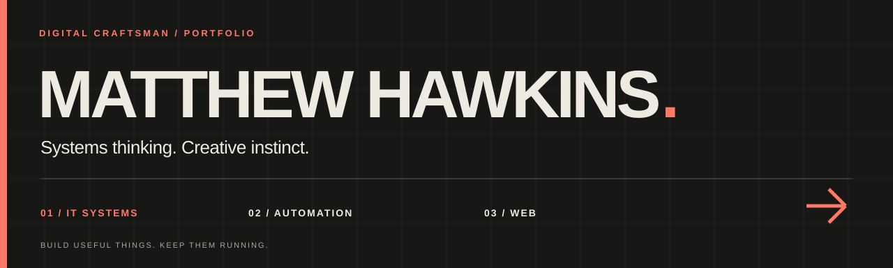
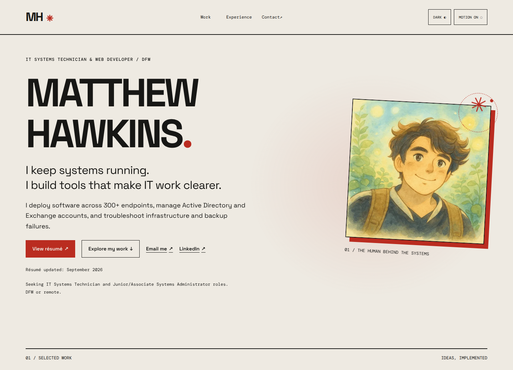
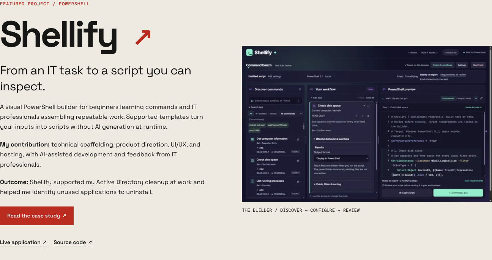
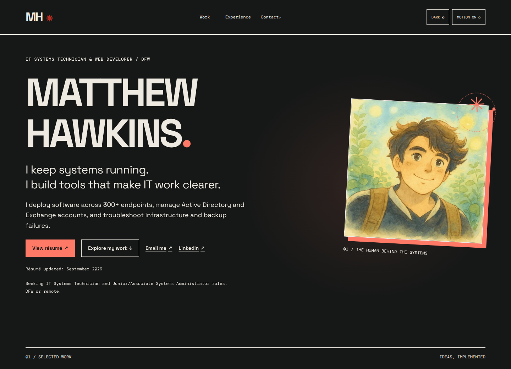
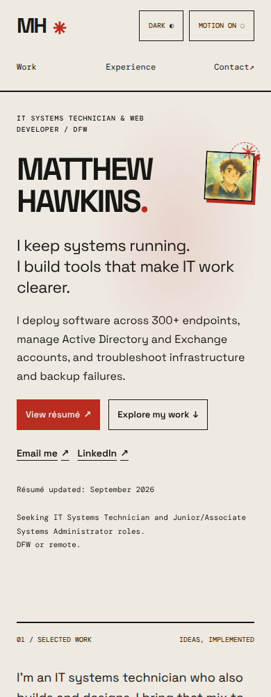

### 🛠️ Reliable systems. Useful tools. A creative streak.

My personal portfolio: the systems I work on, the tools I build, 
and the thinking behind the work.

**[See it live ↗](https://personal-page-47d.pages.dev/)**

## ✳ Where IT meets the creative side.

I work in IT systems and build tools that make technical work clearer. This portfolio brings both sides together: endpoint and infrastructure experience, practical automation, and personal projects with their own visual identity.

Big typography. Cream and charcoal. Red accents. A little motion—and a closer look at what goes into each project.

## ↗ Ideas, implemented.

**Shellify takes the spotlight**, with a dedicated case study covering the problem, my contribution, the design decisions, and an inspectable PowerShell sample.

| Project | The idea | Explore |
| :--- | :--- | :--- |
| **›_ Shellify** | Turn an IT task into PowerShell you can inspect. | [Case study ↗](https://personal-page-47d.pages.dev/shellify.html) |
| **🧟 Z-Raid** | Survive the ruins through character stats, choices, and hidden chance. | [Play ↗](https://z-raid.pages.dev/) |
| **🧩 Promptly** | Turn everyday needs into a structured AI prompt. | [Try it ↗](https://promptly.thehawk6353.workers.dev/#home) |

The portfolio also includes an anonymized backup troubleshooting story, an overview of my IT experience, and links to my résumé and professional profiles.

## ◐ Two moods. One portfolio.

Switch between **light and dark**, pause decorative motion, or follow your device's reduced-motion preferences. The layout adapts for smaller screens, with visible keyboard focus and content that stays available without JavaScript.

<strong>🌒 Dark mode + 📱 mobile</strong>

## ⚙️ A quick look under the hood

Built with **HTML, CSS, and vanilla JavaScript**. Responsive CSS handles the layouts and themes; browser APIs handle scroll feedback, motion, and locally saved display preferences. No framework, build step, or backend.

---

**Build useful things. Keep them running. ✳**

[Portfolio ↗](https://personal-page-47d.pages.dev/) · [LinkedIn](https://www.linkedin.com/in/matthew-hawk/) · [GitHub](https://github.com/Matthew-Hawk)

